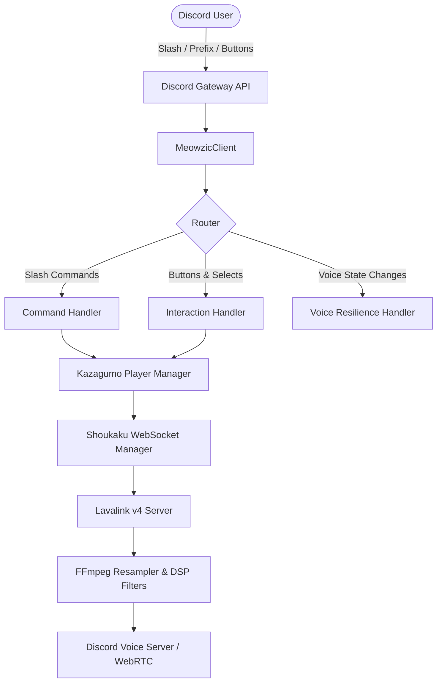

# 🐾 Meowzic — Premium Discord Music Bot

<p align="center">
  
</p>

<p align="center">
  <b>A high-fidelity, ultra-low latency Discord music bot engineered by reverse-engineering Funky Music Bot.</b><br/>
  Built with <b>TypeScript</b>, <b>Node.js (v24)</b>, <b>discord.js (v14)</b>, <b>Lavalink v4</b>, and <b>FFmpeg</b>.
</p>

<p align="center">
  
  
  
  
</p>

---

## 🌟 Key Features

- 🎧 **Studio-Quality Audio**: Distributed **Lavalink v4** audio streaming running out-of-process for crystal-clear 320kbps audio with ~0% Node.js CPU overhead.
- 🔍 **Multi-Platform Smart Search**: Paste links or search queries from **YouTube**, **Spotify** (tracks, albums, playlists), **SoundCloud**, and direct HTTP audio streams.
- 🎛️ **Real-Time DSP Filters**: Bassboost (Low/Medium/High), 8D rotating stereo panning, Nightcore, Vaporwave, Lo-Fi, Karaoke, Tremolo, Vibrato, and Speed controls.
- 🎮 **Interactive ActionRow Controls**: Live progress bar (`🔘▬▬▬▬▬▬▬▬ 01:23 / 03:45`) and dual-row button controls:
  - **Row 1**: `⏮️ Previous` | `⏯️ Play/Pause` | `⏭️ Skip` | `⏹️ Stop` | `🔀 Shuffle`
  - **Row 2**: `🔁 Loop` | `🔉 Vol -` | `🔊 Vol +` | `📜 Queue` | `📻 Autoplay`
- 📻 **Smart Autoplay Engine**: Seamlessly discovers and queues similar recommendations when the queue ends.
- 📜 **Synchronized & Plain Lyrics**: Instant on-screen lyrics lookup powered by Lrclib API.
- 🛡️ **Multi-Server Isolation & Resilience**: Individual queue state per server, empty voice channel auto-disconnect, and optional **24/7 stay mode**.
- ⚡ **Dual Command Interface**: Full support for both modern Discord **Slash Commands (`/`)** and legacy **Prefix Commands (`+`)**.

---

## 📋 Command List

### 🎵 Music Commands
| Slash Command | Prefix Command | Description |
|---|---|---|
| `/play <query>` | `+play <query>` | Play a song or playlist from YouTube, Spotify, SoundCloud |
| `/pause` | `+pause` | Pause the active track |
| `/resume` | `+resume` | Resume paused playback |
| `/skip` | `+skip` / `+s` | Skip to the next track in queue |
| `/skipto <pos>` | `+skipto <pos>` | Skip directly to a specific position in queue |
| `/previous` | `+previous` / `+prev` | Replay the previous song from history |
| `/stop` | `+stop` | Stop playback, clear queue, and leave voice |
| `/queue [page]` | `+queue [page]` | View upcoming tracks with total queue length |
| `/nowplaying` | `+nowplaying` / `+np` | Display current track card with live buttons |
| `/volume <1-150>` | `+volume <level>` | Adjust player volume (1 - 150%) |
| `/loop [mode]` | `+loop [mode]` | Cycle or set loop mode (`off`, `track`, `queue`) |
| `/shuffle` | `+shuffle` | Randomize the order of tracks in the queue |
| `/clear` | `+clear` | Clear upcoming tracks from the queue |
| `/seek <time>` | `+seek <time>` | Jump to a timestamp (e.g. `1:30` or `90s`) |
| `/search <query>` | `+search <query>` | Interactive 5-track selection menu |
| `/lyrics [title]` | `+lyrics [title]` | Display lyrics for current track or queried title |
| `/autoplay` | `+autoplay` | Toggle smart track recommendations |

### 🎛️ Audio DSP Filters
| Command | Presets |
|---|---|
| `/filter <preset>` | `reset`, `bassboost_low`, `bassboost_medium`, `bassboost_high`, `8d`, `nightcore`, `vaporwave`, `lofi`, `karaoke`, `tremolo`, `vibrato`, `treble`, `speed_0.5`, `speed_1.5`, `speed_2.0` |

### ⚙️ Utilities & Info
| Slash Command | Prefix Command | Description |
|---|---|---|
| `/247` | `+247` | Toggle 24/7 voice channel stay mode |
| `/node` | `+node` | Inspect Lavalink server node health and latency |
| `/ping` | `+ping` | Gateway and REST roundtrip latency |
| `/stats` | `+stats` | Host memory, CPU, guilds, and active streams |
| `/help` | `+help` | View complete command directory |

---

## 🚀 Setup & Local Installation

### 1. Prerequisites
- **Node.js** v20.x or v22.x+ (Recommended: Node.js v22 or v24 LTS)
- **Git**
- A Discord Application from the [Discord Developer Portal](https://discord.com/developers/applications)

### 2. Clone the Repository
```bash
git clone https://github.com/hxrshit9/Meowzic.git
cd Meowzic
```

### 3. Install Dependencies
```bash
npm install
```

### 4. Configure Environment Variables
Copy `.env.example` to `.env`:
```bash
cp .env.example .env
```
Open `.env` in VS Code or your preferred text editor and fill in your credentials:
```env
# Discord Bot Credentials
DISCORD_TOKEN=your_bot_token_here
CLIENT_ID=your_client_id_here

# Lavalink Node (Pre-configured with a working free Lavalink v4 server!)
LAVALINK_HOST=lavalink.nazha.online
LAVALINK_PORT=443
LAVALINK_PASSWORD=nazhafreelava
LAVALINK_SECURE=true

# (Optional) Spotify API Credentials for high-res Spotify metadata
SPOTIFY_CLIENT_ID=
SPOTIFY_CLIENT_SECRET=
```
> [!NOTE]
> `.env` is strictly excluded in `.gitignore` to safeguard your credentials. Never commit your `.env` file to git.

### 5. Deploy Slash Commands to Discord
Register all 23 application commands with Discord's REST API:
```bash
npm run deploy
```

### 6. Build & Launch Meowzic
- **Production mode**:
  ```bash
  npm run build
  npm start
  ```
- **Development mode** (with live hot-reloading):
  ```bash
  npm run dev
  ```

---

## 🏗️ Architecture & Design



---

## 📜 License
Distributed under the **MIT License**. Created by [hxrshit9](https://github.com/hxrshit9).
